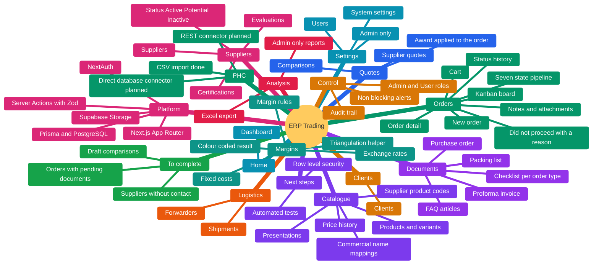
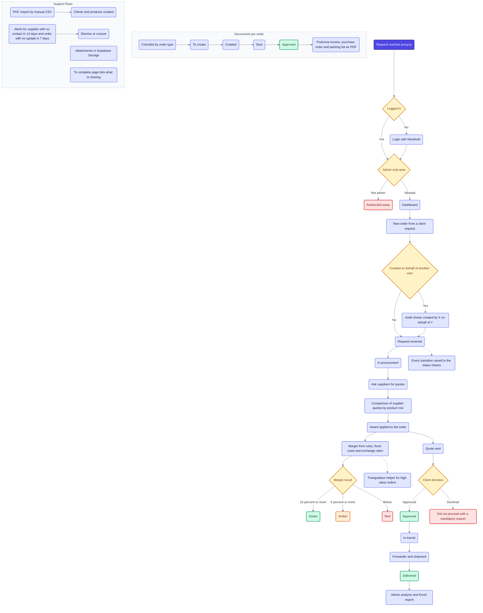

# Architecture

This document explains how ERP Trading is built and why. It is written from the code in this repository (`prisma/schema.prisma`, `src/app`, `src/server`, `src/lib`).

## Map

Everything the app contains, by area.



## Flow from start to end

The main path through the app, with its branches. Blue is a step, yellow a decision, green a good end state, orange a state that needs attention, red a blocked or flagged case.



## 1. What the system does

A web ERP for an international B2B trading company that sources medical and non-medical products from suppliers around the world for clients in Angola. It replaces WhatsApp, email and spreadsheets with one system for orders, suppliers, quotes, margins and shipping documents.

## 2. Big picture

```
 Browser
   |  Next.js App Router (React Server Components + Server Actions)
   v
 Next.js server
   |-- proxy.ts ............ route protection (login, admin-only areas)
   |-- NextAuth ............ credentials login, JWT session
   |-- Server Actions ...... all writes, validated with Zod
   |-- Route handlers ...... PDF generation (react-pdf)
   |-- Prisma ORM .......... PostgreSQL
   '-- Supabase Storage .... attachments (server side, service role)
```

Unlike the Supabase-first projects in this portfolio, this one uses a classic server-side stack. The server is the only thing that talks to the database, and authorization is enforced in application code.

## 3. Request flow

1. A request reaches `proxy.ts`. If the user is not logged in they are redirected to `/login`, and non-admins are redirected away from `/analises` and `/configuracoes`.
2. Pages are server components that read data with Prisma.
3. Writes are **Server Actions** (`src/server/actions/*.ts`). Each one calls `requireUser()` or `requireAdmin()`, validates the input with a Zod schema (`src/lib/validation`), writes with Prisma, and records an audit event.

Server Actions are grouped by domain: orders, procurement, comparisons, margins, products, suppliers, clients, logistics, documents, alerts, attachments, users, PHC import and reports.

## 4. Data model

36 Prisma models. The main groups:

- **Access and audit:** `User` (roles ADMIN and USER), `AuditEvent`.
- **Catalogue:** `Category`, `Product`, `ProductVariant`, `Presentation`, `CommercialNameMapping`, `SupplierProductCode`, `PriceHistory`.
- **Suppliers:** `Supplier`, `Certification`, `SupplierCertification`, `SupplierEvaluation`.
- **Orders:** `Client`, `Order`, `OrderStatusHistory`, `OrderItem`, `OrderNote`, `Attachment`.
- **Quotes and comparison:** `Comparison`, `ComparisonRow`, `ComparisonCell`, `SupplierQuote`, `QuoteLine`.
- **Margins and costs:** `MarginRule`, `OrderMargin`, `FixedCost`, `ExchangeRate`.
- **Logistics and documents:** `Forwarder`, `Shipment`, `DocumentChecklistTemplate`, `OrderDocument`, `FaqArticle`.
- **System:** `SystemSetting`, `AlertDismissal`, `ImportBatch`.

## 5. Order pipeline

An order moves through seven states: request received, in procurement, quote sent, approved, in transit, delivered, and did not proceed. The last one requires a reason (price, deadline, client gave up, product unavailable, competition, other). Every transition is stored in `OrderStatusHistory`. The pipeline is a kanban board with drag and drop (dnd-kit).

## 6. Quote comparison and margins

- A comparison puts supplier quotes side by side for each product row, and an award can be applied to the order.
- Margins are calculated per order with margin rules and fixed costs. A colour code flags the result (15% or more is green, 5% or more is amber, below that is red).
- A helper flags high-value orders that may be candidates for triangulation (a supplier in the EU and a client outside the EU).

## 7. Audit trail

`logAudit` writes an `AuditEvent` with the entity, the action (create, update, delete, status change), who did it, and optionally on whose behalf (an admin can create an order on behalf of another user, shown as "created by X on behalf of Y"), plus a record of the changes.

## 8. Alerts

Alerts are computed from rules and settings stored in `SystemSetting` (for example, a supplier with no contact for 14 days, or an order with no update for 7 days). They are non-blocking, and a user can dismiss or snooze them (`AlertDismissal`).

## 9. Generated documents

Proforma invoice, purchase order and packing list are rendered to PDF on the server with `@react-pdf/renderer` in route handlers under `src/app/api/pdf/`. Each handler checks the session first. A document checklist per order type tracks which documents are ready.

## 10. PHC integration layer

`PhcConnector` is an interface with two operations (import clients, import products). Three implementations exist as options:

- `ManualCsvConnector`: implemented. Reads an Excel or CSV file and imports rows, reporting row errors.
- `RestApiConnector` and `DirectDbConnector`: placeholders that throw "not implemented", to be filled when the level of access to PHC is confirmed.

The rest of the system depends only on the interface, so swapping the connector does not change anything else.

## 11. Authentication and authorization

- NextAuth with the credentials provider and a JWT session. Passwords are stored as bcrypt hashes.
- Two fixed roles, ADMIN and USER. Admin-only areas are protected in `proxy.ts`, and admin-only actions call `requireAdmin()`. Excel export is for admins only.
- Attachments are stored in Supabase Storage using a server-side service role key, which is never sent to the browser.

## 12. Design principles

No blocking mandatory fields (soft warnings instead), non-blocking alerts, mobile-first layout, dark theme by default, and at most two clicks to any action.

## 13. How it was built

Developed with agentic AI coding (Claude Code). The repository includes `CLAUDE.md` and `AGENTS.md` with instructions for AI agents, including a warning that this Next.js version has breaking changes and that the bundled docs must be read before writing code.

## 14. Known limitations and next steps

- Authorization lives in application code, not in the database. There is no row level security, so every query path must go through the checked server actions.
- There is no automated test suite yet.
- The PHC REST and direct database connectors are not implemented.
- The project is in active development.
